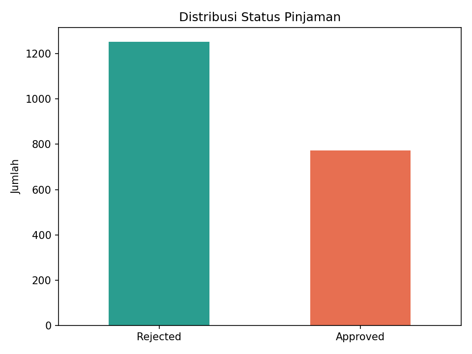
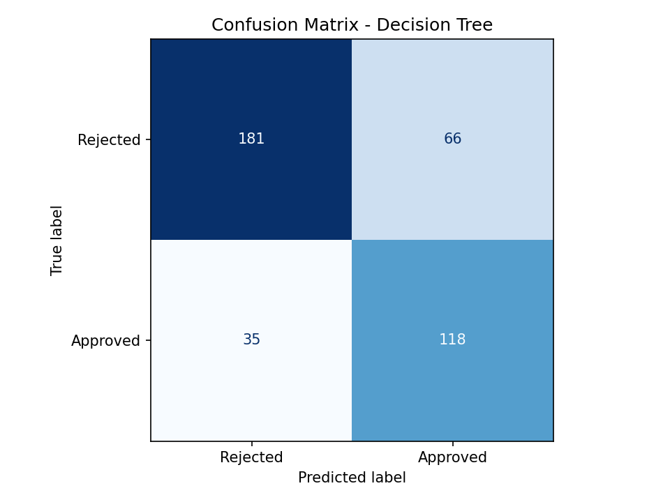
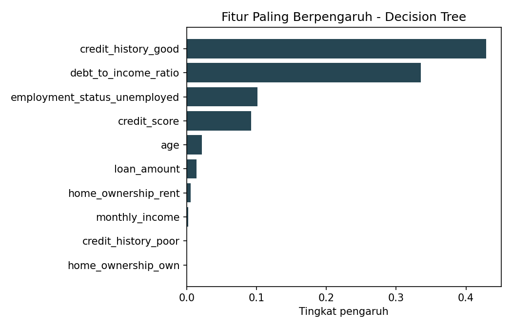
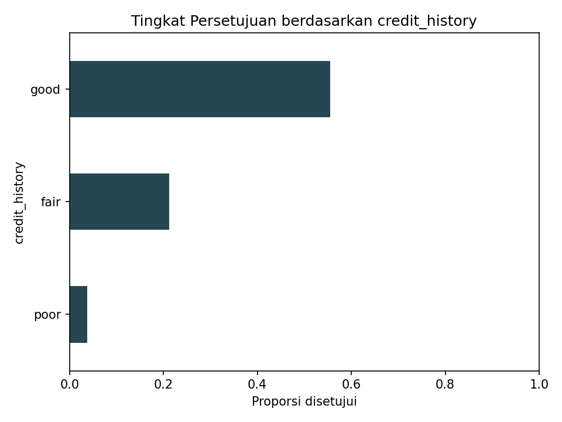

# Loan Approval Prediction

Proyek machine learning untuk memprediksi **persetujuan pinjaman bank** (*Approved* / *Rejected*) menggunakan pendekatan **supervised learning – classification**.

Proyek ini disusun sebagai studi kasus dari materi *Introduction to Machine Learning* (Taniza Tajuddin, UiTM Cawangan Kedah, Informatic Practitioner Lecture Series 2026), dan mengikuti alur kerja machine learning yang dibahas pada kuliah tersebut.

## Ringkasan Hasil

Evaluasi pada 400 data uji (20% dari data):

| Model | Train Acc. | Test Acc. | Precision | Recall | F1 | ROC-AUC | CV F1 (5-fold) |
|---|---|---|---|---|---|---|---|
| **Decision Tree** (terpilih) | 0.7925 | 0.7475 | 0.6413 | 0.7712 | 0.7003 | 0.8052 | 0.7164 |
| Random Forest | 0.8425 | 0.7475 | 0.6667 | 0.6797 | 0.6731 | 0.8381 | 0.7127 |
| Logistic Regression | 0.7719 | 0.7550 | 0.6846 | 0.6667 | 0.6755 | 0.8447 | 0.7017 |

Catatan: selisih antar model kecil. Model dipilih berdasarkan skor cross-validation pada data latih, bukan data uji. Logistic Regression memiliki ROC-AUC tertinggi dan selisih train–test terkecil, sehingga layak dipertimbangkan jika stabilitas lebih diutamakan.

## Keterkaitan dengan Materi Kuliah

| Konsep di materi | Implementasi di proyek |
|---|---|
| Supervised learning dengan data berlabel | Target `loan_status` (Approved/Rejected) sudah diketahui |
| Classification (output biner: disetujui atau ditolak) | Model klasifikasi biner |
| Input features / atribut / kolom | `credit_score`, `employment_status`, `debt_to_income_ratio`, dll. |
| Data collection | `src/generate_data.py` |
| Cleaning: duplikat dan missing value | `clean_data()` dan `SimpleImputer` di `src/preprocessing.py` |
| Konversi teks ke angka | `OneHotEncoder` untuk fitur kategorikal |
| Normalisasi data numerik | `StandardScaler` |
| Split training dan testing (80/20) | `split_train_test()` dengan stratifikasi |
| Memilih algoritma | Logistic Regression, Decision Tree, Random Forest (`src/train.py`) |
| Evaluasi: accuracy, precision, recall, F1, confusion matrix | `src/evaluate.py` |
| Overfitting dan underfitting | Kolom `gap_train_test` pada laporan metrik |
| Inference pada data baru | `src/predict.py` |
| *Good data → good prediction* | Pipeline preprocessing dibuat terlebih dahulu dan diuji |
| Etika: bias, transparansi, explainability | Bagian [Catatan Etika](#catatan-etika) dan grafik feature importance |

## Struktur Proyek

```
loan-approval-ml/
├── data/
│   └── loan_data.csv          # dataset sintetis
├── models/
│   └── loan_model.joblib      # pipeline terlatih
├── reports/
│   ├── metrics.csv            # perbandingan model
│   └── figures/               # grafik EDA dan evaluasi
├── src/
│   ├── config.py              # konfigurasi dan konstanta
│   ├── generate_data.py       # pembuatan dataset
│   ├── eda.py                 # eksplorasi data
│   ├── preprocessing.py       # cleaning, split, transformasi
│   ├── train.py               # pelatihan dan pemilihan model
│   ├── evaluate.py            # metrik dan visualisasi
│   └── predict.py             # inference via CLI
├── tests/
│   └── test_pipeline.py
├── requirements.txt
└── README.md
```

## Dataset

Dataset **sintetis** (2.025 baris, termasuk 25 duplikat dan beberapa missing value yang sengaja disertakan) dihasilkan oleh `src/generate_data.py` dengan seed tetap agar dapat direproduksi. Data bukan berasal dari nasabah nyata.

| Kolom | Tipe | Keterangan |
|---|---|---|
| `age` | numerik | Usia pemohon |
| `monthly_income` | numerik | Penghasilan bulanan (Rupiah) |
| `loan_amount` | numerik | Jumlah pinjaman (Rupiah) |
| `loan_term_months` | numerik | Tenor pinjaman (bulan) |
| `credit_score` | numerik | Skor kredit (300–850) |
| `debt_to_income_ratio` | numerik | Rasio cicilan terhadap penghasilan |
| `employment_status` | kategorikal | employed, self_employed, unemployed |
| `credit_history` | kategorikal | good, fair, poor |
| `home_ownership` | kategorikal | own, rent, mortgage |
| `loan_status` | target | Approved / Rejected |

Karena label dibangkitkan dari aturan probabilistik buatan, performa model di sini tidak mencerminkan performa pada data kredit riil.

## Cara Menjalankan

```bash
git clone https://github.com/<username>/loan-approval-ml.git
cd loan-approval-ml

python -m venv .venv
source .venv/bin/activate        # Windows: .venv\Scripts\activate
pip install -r requirements.txt
```

Jalankan secara berurutan dari folder utama proyek:

```bash
python -m src.generate_data      # 1. membuat dataset
python -m src.eda                # 2. eksplorasi data
python -m src.train              # 3. melatih dan membandingkan model
python -m pytest                 # 4. menjalankan pengujian
```

### Prediksi Pemohon Baru

```bash
python -m src.predict \
  --age 32 \
  --monthly-income 9000000 \
  --loan-amount 40000000 \
  --loan-term-months 36 \
  --credit-score 720 \
  --debt-to-income-ratio 0.22 \
  --employment-status employed \
  --credit-history good \
  --home-ownership own
```

Contoh keluaran:

```
Keputusan             : Approved
Probabilitas disetujui: 66.84%
```

## Alur Kerja

1. **Pengumpulan data**: dataset dibuat dan disimpan ke `data/loan_data.csv`.
2. **Eksplorasi**: pengecekan dimensi, duplikat, missing value, dan distribusi target (62% Rejected, 38% Approved).
3. **Preprocessing**: hapus duplikat; imputasi median (numerik) dan modus (kategorikal); standardisasi; one-hot encoding. Semua langkah berada dalam satu `Pipeline` agar tidak terjadi *data leakage*.
4. **Split data**: 80% latih, 20% uji, terstratifikasi berdasarkan target.
5. **Pelatihan**: tiga algoritma dibandingkan dengan 5-fold cross-validation pada data latih.
6. **Evaluasi**: metrik dihitung pada data uji yang belum pernah dilihat model.
7. **Deployment**: model terbaik disimpan sebagai `loan_model.joblib` dan dipakai oleh `predict.py`.

## Visualisasi

| | |
|---|---|
|  |  |
|  |  |

## Catatan Etika

Materi kuliah menekankan bahwa sistem ML harus adil, transparan, dan akuntabel, terutama pada domain persetujuan pinjaman.

- **Bias**: model belajar dari data historis. Jika data riil memuat bias, model akan mereproduksinya. Pada penerapan nyata, hindari fitur sensitif atau proksinya (misalnya usia atau lokasi) tanpa audit kewajaran.
- **Explainability**: grafik feature importance dan penggunaan Decision Tree/Logistic Regression memudahkan penjelasan alasan keputusan kepada pemohon.
- **Human oversight**: keputusan model sebaiknya menjadi pertimbangan awal, dengan peninjauan manusia untuk kasus batas.
- **Privasi**: data kredit riil tunduk pada regulasi perlindungan data pribadi.

## Keterbatasan dan Pengembangan Lanjutan

- Data sintetis, belum diuji pada data kredit riil.
- Hyperparameter belum dioptimasi (misalnya dengan `GridSearchCV`).
- Belum ada penanganan ketidakseimbangan kelas selain stratifikasi.
- Dapat ditambahkan SHAP untuk penjelasan per prediksi dan API (FastAPI) untuk deployment.

## Lisensi

MIT
